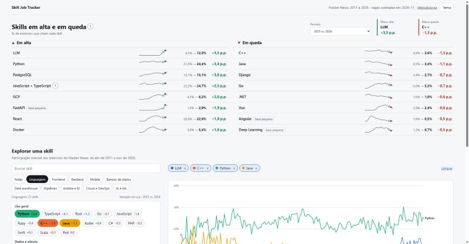

# 📈 Skill Job Tracker

### *Quais skills de tecnologia sobem e descem nos anúncios de vagas, medido todo mês*

[-4169E1.svg)](https://www.postgresql.org/)

**Pipeline medalhão que coleta vagas de 106 fontes públicas, guarda o raw em JSONL, refina em Bronze, Silver e Gold (Parquet, DuckDB, dbt) e publica um dashboard estático no GitHub Pages. Roda sozinho todo mês no GitHub Actions.**

[**Ver o dashboard**](https://samuelmel.github.io/skill-job-tracker/)

---

## 🌟 Principais Funcionalidades

### 1. 🔌 Coleta de 106 fontes públicas

Um conector por plataforma de vagas, todos sobre o mesmo cliente HTTP.

* **106 fontes** em 44 plataformas (Greenhouse, Lever, Ashby, Workday, entre outras).
* **Cliente HTTP** com User-Agent identificável, retry com backoff, `Retry-After` e rate limit por domínio. Respeita robots.txt e não contorna login, CAPTCHA nem Cloudflare.
* **`complete=False`** sempre que a listagem pode estar truncada. Campo ausente vira `None`.

### 2. 🗄️ Raw imutável e camadas Bronze, Silver e Gold

Cada coleta vira arquivos que nunca são reescritos; o resto é derivado deles.

* **Raw:** `jobs.jsonl.gz` e `manifest.json` por fonte e execução. Bronze e warehouse podem ser apagados e reconstruídos.
* **Bronze** em **Parquet** (`pyarrow`), **Silver** e **Gold** em **DuckDB** via **dbt**, com 136 skills em um dicionário versionado.
* O Postgres embutido guarda o estado operacional (dedup, `job_history`, `fetch_runs`) e a reconciliação só fecha vagas em coleta completa.

### 3. 📐 Regras de tendência que evitam falsa alta

A tendência mensal segue regras fixas.

* **Denominador:** só vagas com descrição.
* **Painel comparável:** só entram fontes com coleta completa nos dois meses comparados. Fonte nova ou run `PARTIAL` fica de fora.
* **Alta ou queda** exige |z| ≥ 1,96 e variação de pelo menos 0,5 p.p.; abaixo de 30 vagas no denominador a skill é marcada como base pequena.

### 4. 🕰️ Série histórica do Hacker News

Uma série separada, de abr/2011 a nov/2026, a partir das threads "Ask HN: Who is hiring?".

* Carga avulsa e build próprio, com sha256 conferido por thread.
* A carga mensal passa pelas fontes de vagas e **não** pelo Hacker News.
* Nas altas e quedas por mudança de nomenclatura, **JavaScript e TypeScript** são somados em uma linha só.

### 5. 🤖 Carga mensal automatizada

Um workflow do GitHub Actions roda todo dia 1 e também sob demanda.

* Restaura o raw de um **repositório privado de dados**, reconstrói Bronze e warehouse, coleta, devolve só o raw novo e publica no **GitHub Pages**.
* **Gate de cobertura:** com menos de 50% das fontes tentadas em SUCCEEDED/PARTIAL, o dashboard não é refeito e a versão anterior continua no ar.
* `concurrency` impede duas cargas ao mesmo tempo, e só o HTML é publicado, barrando caminhos locais e referências a raw.

---

## 🏗️ Arquitetura

O fluxo principal pode ser resumido como:

**Fontes → Raw → Bronze → Silver → Gold → Dashboard**

---

## 📊 Resultados

### O dashboard

<em>Topo do dashboard: altas e quedas em pontos percentuais entre 2025 e 2024, com sparkline por skill, e o seletor de skills por área.</em>

Última coleta real conhecida, de novembro de 2026:

| Medida | Coleta de nov/2026 |
|---|---|
| Fontes tentadas | 106 |
| Fontes com coleta completa | 94 |
| Vagas únicas (fontes com coleta completa) | 11.657 |

Skills com base pequena aparecem com o selo "base pequena" no dashboard, e não há ranking de skill sem o denominador de vagas com descrição.

---

**samuelmel**

Este projeto foi desenvolvido como **portfólio técnico e projeto de estudo**, com foco em engenharia de dados (arquitetura medalhão, dbt e automação).

Dados: páginas públicas de vagas de cada empresa e as threads públicas "Ask HN: Who is hiring?" do Hacker News.
