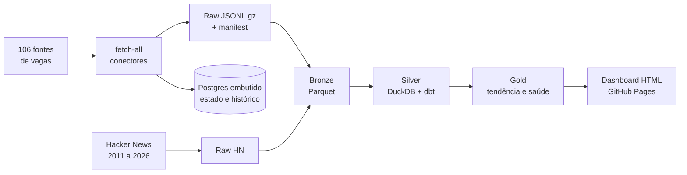

<div align="center">

# 📈 Skill Job Tracker

### *Quais skills de tecnologia sobem e descem nos anúncios de vagas, medido todo mês*

[](https://www.python.org/)
[](https://duckdb.org/)
[](https://www.getdbt.com/)
[](https://arrow.apache.org/)
[-4169E1.svg)](https://www.postgresql.org/)
[](.github/workflows/monthly.yml)

**Pipeline medalhão que coleta vagas de 106 fontes públicas, guarda o raw em JSONL, refina em Bronze, Silver e Gold (Parquet, DuckDB, dbt) e publica um dashboard estático no GitHub Pages. Roda sozinho todo mês no GitHub Actions.**

[**Ver o dashboard**](https://samuelmel.github.io/skill-job-tracker/)

</div>

---

## 🌟 Principais Funcionalidades

### 1. 🔌 Coleta de 106 fontes públicas

Um conector por plataforma de vagas, todos sobre o mesmo cliente HTTP.

* **106 fontes** em [`catalog/sources.json`](catalog/sources.json), em 44 plataformas (Greenhouse, Lever, Ashby, Workday, entre outras), com conectores em `src/vaya_indexer/connectors/`.
* **`HttpClient`** com User-Agent identificável, retry com backoff, `Retry-After` e rate limit por domínio. Respeita robots.txt e não contorna login, CAPTCHA nem Cloudflare.
* **`complete=False`** sempre que a listagem pode estar truncada. Campo ausente vira `None`.

### 2. 🗄️ Raw imutável e camadas Bronze, Silver e Gold

Cada coleta vira arquivos que nunca são reescritos; o resto é derivado deles.

* **Raw:** `jobs.jsonl.gz` e `manifest.json` por fonte e execução. Bronze e warehouse podem ser apagados e reconstruídos.
* **Bronze** em **Parquet** (`pyarrow`), **Silver** e **Gold** em **DuckDB** via **dbt** (`analytics/models/`), com [136 skills](analytics/seeds/skills.csv) em um dicionário versionado.
* O Postgres embutido guarda o estado operacional (dedup, `job_history`, `fetch_runs`) e a reconciliação só fecha vagas em coleta completa.

### 3. 📐 Regras de tendência que evitam falsa alta

A tendência mensal (`gold_skill_trend.sql`) segue regras fixas.

* **Denominador:** só vagas com descrição.
* **Painel comparável:** só entram fontes com coleta completa nos dois meses comparados. Fonte nova ou run `PARTIAL` fica de fora.
* **Alta ou queda** exige |z| ≥ 1,96 e variação de pelo menos 0,5 p.p.; abaixo de 30 vagas no denominador a skill é marcada como base pequena.

### 4. 🕰️ Série histórica do Hacker News

Uma série separada, de abr/2011 a nov/2026, a partir das threads "Ask HN: Who is hiring?".

* Carga avulsa (`scripts/load_history_hn.py`) e build próprio (`scripts/build_history.py`), com sha256 conferido por thread.
* A carga mensal passa pelas fontes de vagas e **não** pelo Hacker News.
* Nas altas e quedas por mudança de nomenclatura, **JavaScript e TypeScript** são somados em uma linha só.

### 5. 🤖 Carga mensal automatizada

[`monthly.yml`](.github/workflows/monthly.yml) roda com cron `17 6 1 * *` e também sob demanda.

* Restaura o raw de um **repositório privado de dados**, reconstrói Bronze e warehouse, coleta, devolve só o raw novo e publica no **GitHub Pages**.
* **Gate de cobertura:** com menos de 50% das fontes tentadas em SUCCEEDED/PARTIAL, o dashboard não é refeito e a versão anterior continua no ar.
* `concurrency` impede duas cargas ao mesmo tempo e `scripts/prepare_site.py` publica só o HTML, barrando caminhos locais e referências a raw.

---

## 🏗️ Arquitetura



O fluxo principal pode ser resumido como:

**Fontes → Raw → Bronze → Silver → Gold → Dashboard**

Plano e decisões de projeto em [`docs/plano-plataforma-dados.md`](docs/plano-plataforma-dados.md).

---

## 📊 Resultados

### O dashboard

<div align="center">


<p><em>Topo do dashboard: altas e quedas em pontos percentuais entre 2025 e 2024, com sparkline por skill, e o seletor de skills por área.</em></p>

</div>

Última coleta real conhecida, de novembro de 2026 (uma nova execução estava em andamento ao escrever este README):

| Medida | Coleta de nov/2026 |
|---|---|
| Fontes tentadas | 106 |
| SUCCEEDED / PARTIAL / FAILED | 90 / 14 / 2 |
| Vagas coletadas | 13.453 |

Skills com base pequena aparecem com o selo "base pequena" no dashboard, e não há ranking de skill sem o denominador de vagas com descrição.

---

## ⚡ Quickstart

### 1. Preparar o ambiente

```bash
git clone https://github.com/samuelmel/skill-job-tracker.git
cd skill-job-tracker
uv sync --frozen
```

No Git Bash: `export UV_CACHE_DIR="$PWD/.uvcache"` antes de qualquer `uv`. No Windows, o cache do `uv` precisa ficar na mesma unidade do projeto.

### 2. Rodar uma carga reduzida

```bash
uv run python scripts/run_monthly.py --platform greenhouse --limit 5
```

Sobe o Postgres embutido em `.pgdata-lake`, coleta, monta Bronze, roda o dbt e gera `data/reports/index.html`. Faz requisições reais às fontes. Esta forma reduzida não foi executada na redação do README; a carga completa roda no Actions.

### 3. Reprocessar sem coletar

```bash
uv run python scripts/run_monthly.py --skip-collect
```

### 4. Histórico do Hacker News

```bash
uv run python scripts/load_history_hn.py    # baixa as threads (rede)
uv run python scripts/build_history.py      # bronze + modelos dbt com tag history
```

O repositório privado de dados com o raw acumulado não faz parte do quickstart. Quem clona começa do zero e gera o próprio raw.

---

## 💻 Exemplos de Uso

Saída real de `uv run vaya --help` e de `uv run vaya lake --help` (trecho):

```text
{seed-platforms,add-source,fetch,load-catalog,fetch-all,list-jobs,verify,lake,coverage-report}
    load-catalog        Carrega catalog/sources.json no banco (idempotente)
    fetch-all           Ingere todas as sources ativas gravando o raw no lake
    verify              Roda o conector contra instancias reais e grava evidencia de cobertura
    lake                Pipeline analitico offline (bronze, dbt, dashboard)

{bronze,dbt,dashboard,monthly}
    monthly             bronze + dbt build + dashboard
```

Para testar um conector contra instâncias reais, com Postgres embutido:

```bash
uv run python scripts/verify_local.py --data-dir .pgdata-verify-x ashby lever-co
```

---

## 🧪 Testes Automatizados

```bash
uv run ruff check . && uv run ruff format --check . && uv run mypy src && uv run pytest -q
```

São 330 funções `test_` em `tests/unit`, `tests/mocked`, `tests/contract` e `tests/integration`, e o contrato de cada conector é descoberto a partir de `connectors/fixtures/`. A suíte não foi executada na redação do README, que mudou só documentação. Os testes marcados `live` acessam a rede e ficam fora do padrão (`pytest -m live`).

---

## 🗂️ Estrutura do Repositório

```
.github/workflows/   monthly.yml: carga mensal e deploy no Pages
analytics/           projeto dbt: staging, silver, gold, history e seed de skills
catalog/             sources.json com as 106 fontes
docs/                plano, guia de conectores, cobertura e pesquisa por plataforma
migrations/          Alembic (estado operacional no Postgres)
scripts/             run_monthly, collect_local, build_history, prepare_site, sync_data_repo
src/vaya_indexer/    conectores, ingestão, lake (raw, bronze, warehouse, dashboard)
tests/               unit, mocked, contract, integration e live
```

---

## 📚 Documentação

* [`docs/plano-plataforma-dados.md`](docs/plano-plataforma-dados.md): objetivo, arquitetura alvo e decisões por fase.
* [`docs/connectors.md`](docs/connectors.md): como adicionar e verificar um conector.
* [`docs/coverage.md`](docs/coverage.md): cobertura por plataforma, gerada por `vaya coverage-report` (posição de 19/11/2026).
* [`docs/research/`](docs/research/): endpoints, paginação e campos por plataforma.

## 🚧 Limitações e Próximos Passos

* **Cobertura:** 43 de 78 plataformas do catálogo têm evidência real, segundo o relatório de 19/11/2026. A amostra é de 106 empresas, não do mercado inteiro.
* **Série mensal curta:** a tendência entre meses de vagas depende de meses acumulados e de painel comparável. Hoje só a série do Hacker News tem profundidade.
* **Viés do Hacker News:** o histórico representa anúncios de uma comunidade, não o mercado geral.
* **Skills por texto:** a classificação usa padrões sobre a descrição e não foi medida contra uma amostra rotulada.
* **Nome do pacote:** o código ainda usa `vaya_indexer` e o comando `vaya`; renomear não foi feito.
* **Idioma:** não existe versão em inglês deste README.

---

**samuelmel**

Este projeto foi desenvolvido como **portfólio técnico e projeto de estudo**, com foco em engenharia de dados (arquitetura medalhão, dbt e automação).

Dados: páginas públicas de vagas de cada empresa e as threads públicas "Ask HN: Who is hiring?" do Hacker News.
